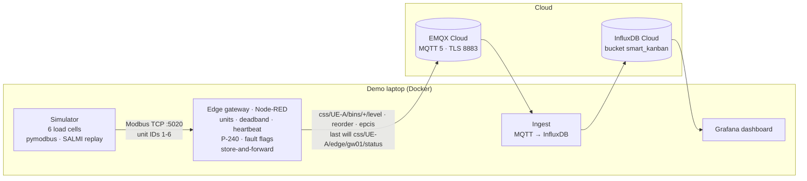
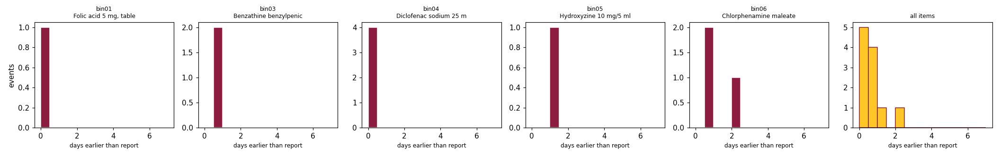
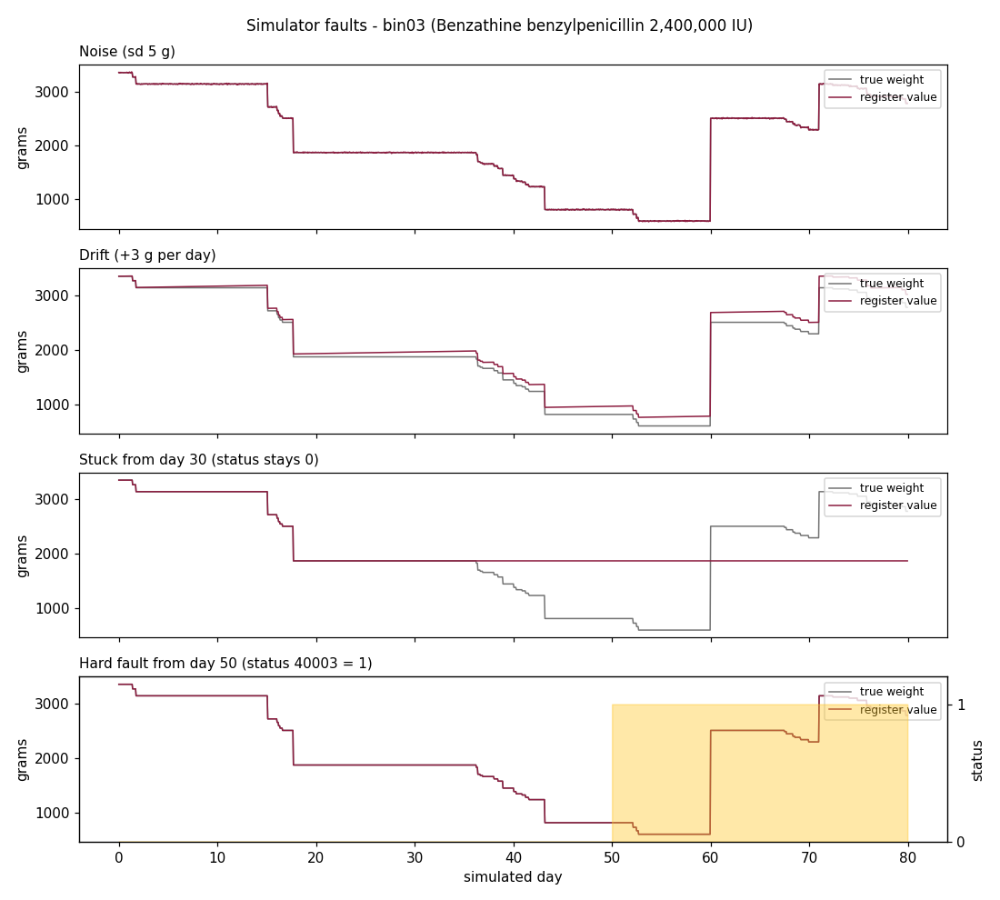

# Simulated Smart Kanban Bins

MFG 598 Industrial Internet of Things · Arizona State University · Fall 2026
Group project: D. Bethancourth, D. Jaladi, F. Rumwaropen · Instructor: Dr. Farhad Ameri

**Work plan:** https://diegobethancourth.github.io/smart_kanban_bins/

## Summary

Public health facilities of the Caja de Seguro Social (CSS) report their medicine stock on fixed
dates, so a reorder point can be crossed days before anyone sees it. This project builds a
simulated IIoT chain that watches the stock continuously. Six load cells under Kanban bins
(simulated in Python) replay the real SALMI stock series of six medicines at one facility (UE-A).
A Node-RED edge gateway polls them over Modbus TCP, converts grams to units, and applies the CSS
P-240 rule (ROP = d̄·L + z·σ_d·√L). It flags faulty or stuck sensors instead of ordering, and
buffers messages when the network drops. Data travels as MQTT 5.0 over TLS to EMQX Cloud, is
written to InfluxDB Cloud at the edge timestamp, and is shown in a Grafana dashboard: the stock
sawtooth with the ROP line, a table of reorder events, and the gateway status from the MQTT last
will. Reorder events are also published as GS1 EPCIS 2.0 events. A detection-latency analysis
compares when the sensors see each crossing with the report date that would show it.

## Architecture



## Repository layout

```
config/      bins.yaml (source of truth, with a source for every value) → bins.json (generated)
data/        anonymised SALMI stock series for the six items at UE-A
simulator/   Modbus TCP server, replay engine, sensor faults, tests
edge/        Node-RED flow, settings, lib/p240.js (P-240 rule), lib/epcis.js, tests
cloud/       ingest service (MQTT → InfluxDB), local Mosquitto config
dashboard/   Grafana provisioning and dashboard JSON
tools/       config builder and checker, fault plot, EPCIS validator, latency analysis
docs/        work plan (GitHub Pages), register map, schema, decisions, latency, checklist, demo script
```

## Reproduce the demo

You need [Docker Desktop](https://www.docker.com/products/docker-desktop/) and Git.

```bash
git clone https://github.com/diegobethancourth/smart_kanban_bins.git
cd smart_kanban_bins
cp .env.example .env          # Windows PowerShell: copy .env.example .env
# fill in .env: MQTT_URL, MQTT_USER, MQTT_PASS, INFLUX_URL, INFLUX_ORG, INFLUX_TOKEN
docker compose up --build
```

Then open:

| What | Where |
|---|---|
| Dashboard | http://localhost:3000 |
| Node-RED edge flow | http://localhost:1880 |
| Raw MQTT messages | MQTT Explorer → your EMQX address, port 8883, TLS on, subscribe `css/#` |
| Modbus registers | `modpoll -m tcp -p 5020 -a 1 -r 1 -c 6 localhost` |

The replay of 131 days takes about 22 minutes (`SIM_SECONDS_PER_DAY=10`). Set `SIM_START_DAY` in
`.env` to start later in the series, and `SIM_FAULTS` to switch on a fault
(for example `bin03.stuck_from_day=30`).

On a Linux host, if Node-RED cannot write to its folder, run `sudo chown -R 1000:1000 edge` once
(Docker Desktop on Windows and macOS does not need this).

**No internet or blocked ports?** Run everything on the laptop:

```bash
cp .env.local.example .env.local
docker compose --profile local --env-file .env.local up --build
```

## Tests

```bash
pip install -r tools/requirements.txt -r simulator/requirements.txt -r cloud/ingest/requirements.txt
python tools/check_config.py              # every bin value filled and sourced
python tools/build_config.py --check      # bins.json matches bins.yaml
python -m pytest simulator/tests cloud/ingest
node --test "edge/test/*.test.js"                    # P-240 against the CSS dashboard values
```

## Results

**Detection latency (T3.6).** In a full replay through the whole chain, the bins saw 11 reorder-point
crossings on average **0.75 days** (median 0.50, max 2.37) before the SALMI report that showed them.
The gain is small because UE-A reported almost daily (median gap 1 day); it grows with the gap
between reports. The result is model-based: the stock path between report dates is simulated.
Details and limits: [docs/latency.md](docs/latency.md).



**Tested end to end** (simulator → Node-RED → MQTT 5 broker → ingest): units equal the simulator
in 526 of 526 messages with noise off; one reorder per crossing; a stuck or faulty bin is flagged
and never reorders; 109 of 109 messages arrive after a 30 s broker outage (store-and-forward);
`offline` is published at once after a crash or a stop (last will / close message).



Dashboard screenshots: to be added from the first full run against the cloud services (`docs/img/`).

## Documentation

- [Register map](docs/register_map.md) · [MQTT and InfluxDB schema](docs/schema.md) · [Decisions](docs/decisions.md)
- [Detection-latency analysis](docs/latency.md) · [EPCIS example](docs/epcis_example.json)
- [Privacy and quality checklist](docs/checklist.md) · [Demo script](docs/demo_script.md)

## Rules for this repository

- The repository is public. Commit only aggregated, anonymised data (facility shown as UE-A); no names, endpoints or credentials.
- Credentials go in a local `.env` file, which is ignored by git. Share them privately, never in a commit, issue or pull request.
- Work on a branch and open a pull request; another member reviews before merging to `main`.
