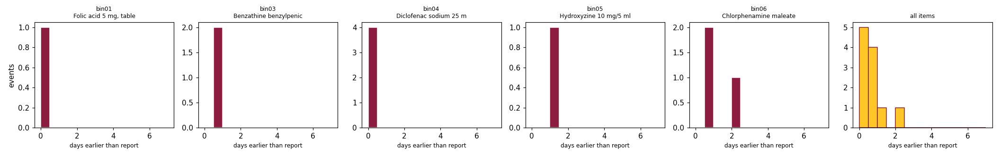

# Detection-latency analysis (T3.6)

How much earlier does a sensed bin detect a P-240 reorder-point (ROP) crossing than the SALMI stock report would?

## Method

1. A full replay of the 92 UE-A report dates (8 Jun - 17 Oct 2026) runs through the whole chain: simulator -> Modbus -> Node-RED edge (units, deadband, P-240 with hysteresis) -> MQTT -> ingest.
2. For each reorder event published by the edge, the **sensed time** is the simulated time of the reading that crossed the ROP (`sim_min`, read from the simulator registers 40004-40005).
3. The **report time** is the first SALMI report date, at or after the sensed time, on which the reported stock is at or below the same ROP.
4. **Latency = report time - sensed time**, in days. Positive means the sensor saw the crossing earlier.
5. Events where the last report *before* the event already showed the stock at or below the ROP are excluded: there the report, not the sensor, saw it first (this happens when a bin starts the series already below its ROP).

Input: `full_run_reorder.csv`, replay cycle 0, 12 reorder events. Generated by `python tools/latency.py`.

## Result per event

| Bin | Item | Sensed (simulated date) | Units | ROP | First report <= ROP | Reported stock | Latency (days) |
|---|---|---|---|---|---|---|---|
| bin01 | Folic acid 5 mg | 2026-07-01 13h | 2677 | 2863.6 | 2026-07-02 | 2000 | 0.43 |
| bin03 | Benzathine benzylpenicillin 2 | 2026-06-25 01h | 79 | 79.9 | 2026-06-26 | 60 | 0.93 |
| bin03 | Benzathine benzylpenicillin 2 | 2026-09-30 10h | 75 | 79.9 | 2026-10-01 | 69 | 0.57 |
| bin04 | Diclofenac sodium 25 mg/ml | 2026-06-23 18h | 131 | 132.0 | 2026-06-24 | 125 | 0.23 |
| bin04 | Diclofenac sodium 25 mg/ml | 2026-07-12 13h | 130 | 132.0 | 2026-07-13 | 130 | 0.42 |
| bin04 | Diclofenac sodium 25 mg/ml | 2026-07-28 16h | 130 | 132.0 | 2026-07-29 | 130 | 0.31 |
| bin04 | Diclofenac sodium 25 mg/ml | 2026-09-23 14h | 105 | 132.0 | 2026-09-24 | 105 | 0.38 |
| bin05 | Hydroxyzine 10 mg/5 ml syrup | 2026-07-18 16h | 15 | 16.0 | 2026-07-20 | 14 | 1.32 |
| bin06 | Chlorphenamine maleate 2-2.5 mg/5 ml syrup | 2026-06-08 08h | 44 | 70.6 | 2026-06-08 | 43 | excluded: report of 2026-06-08 already showed 43 |
| bin06 | Chlorphenamine maleate 2-2.5 mg/5 ml syrup | 2026-08-09 11h | 70 | 70.6 | 2026-08-10 | 69 | 0.50 |
| bin06 | Chlorphenamine maleate 2-2.5 mg/5 ml syrup | 2026-08-30 05h | 70 | 70.6 | 2026-08-31 | 67 | 0.79 |
| bin06 | Chlorphenamine maleate 2-2.5 mg/5 ml syrup | 2026-10-02 15h | 70 | 70.6 | 2026-10-05 | 50 | 2.37 |

## Summary per item

| Bin | Item | Events | Mean latency (days) | Min | Max |
|---|---|---|---|---|---|
| bin01 | Folic acid 5 mg | 1 | 0.43 | 0.43 | 0.43 |
| bin02 | Paracetamol (acetaminophen) 500 mg | 0 | - | - | - |
| bin03 | Benzathine benzylpenicillin 2 | 2 | 0.75 | 0.57 | 0.93 |
| bin04 | Diclofenac sodium 25 mg/ml | 4 | 0.33 | 0.23 | 0.42 |
| bin05 | Hydroxyzine 10 mg/5 ml syrup | 1 | 1.32 | 1.32 | 1.32 |
| bin06 | Chlorphenamine maleate 2-2.5 mg/5 ml syrup | 3 | 1.22 | 0.50 | 2.37 |

**All items:** 11 events, mean 0.75 days, median 0.50 days, max 2.37 days earlier than the report.

For context: UE-A reported on 92 dates in 131 days (gap between reports: median 1 day, max 4 days). The gain from sensing grows with that gap: a facility that reports weekly would see crossings up to about a week later than the bins do.

## Limits

- **The result is model-based.** Between two report dates the stock path is simulated (Poisson-like daily consumption, rescaled to the observed drop). The real path is unknown, so the sensed time is what a bin *would* have seen under that model, not a measurement.
- The latency can never be negative here: the replay equals the SALMI value on every report date, and stock only falls between reports, so the crossing is always sensed on or before the report that shows it. The size of the gain depends mostly on the gap between report dates.
- Receipts are placed exactly on report dates; a delivery between reports in reality could hide a crossing that the reports never show.
- The edge polls every second and one simulated day lasts `SIM_SECONDS_PER_DAY` seconds (10 in this run), so the sensed time has a resolution of about 0.1 day.
- Paracetamol (bin02) never falls below its ROP in this period, so it has no events.
- One facility (UE-A), six items and one period: the numbers illustrate the method, they do not generalise to the CSS network.
